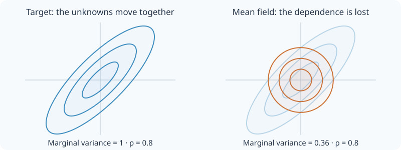

Before asking how to maximize the ELBO, we have to decide what sort of distribution we are willing to fit. An unrestricted joint density is usually no easier to manipulate than the target itself. Mean field makes the first compromise: preserve uncertainty within chosen blocks, but omit dependence between blocks. This is a restriction on *our approximation*, not a declaration that the model's unknowns are independent.

\[
q_\phi(z)=\prod_{j=1}^Jq_{\phi_j}(z_j).
\]

We abbreviate each factor as \(q_j\). Under \(q_1(z_1)q_2(z_2)\), drawing a large \(z_1\) does not make a large \(z_2\) more likely. Each block can still contain several dependent unknowns; independence is imposed between blocks.

This makes sampling and density evaluation simple: draw each block separately and add their log densities. The target still couples the optimization problems, so the best choice for one factor depends on the others. **MFVI chooses the family; [CAVI](#paper-1) or gradient methods choose its parameters.**

**The cost is lost geometry.** A correlated Gaussian has tilted contours, whereas a product of scalar Gaussians has axis-aligned contours.

<figure class="vi-mfvi-figure">

<figcaption>Blue: correlated target. Orange: best reverse-KL mean-field fit. The center is correct, but the dependence is missing.</figcaption>
</figure>

For example,

\[
\pi=\mathcal N\!\left(0,\begin{bmatrix}1&\rho\\\rho&1\end{bmatrix}\right),
\qquad
q^\star=\mathcal N\!\left(0,(1-\rho^2)I\right).
\]

The true marginal variances are \(1\), but at \(\rho=0.8\) the fitted variances are \(0.36\). Widening independent factors would put mass outside the narrow tilted region, so reverse KL favors a narrower approximation.

**When it helps.** Mean field offers inexpensive inference when dependencies are weak or speed matters. Strong correlations can make uncertainty too narrow, and separated modes can lead to a fit around just one mode. Larger blocks, [flows](#paper-34), or [hierarchical approximations](#paper-37) can retain more structure.

The independence assumption belongs to the approximation \(q_\phi\), not to the target \(\pi\). The featured Peterson–Anderson paper uses mean-field equations and factorized correlations to replace expensive sampling during Boltzmann-machine learning. The broader MFVI idea below is a choice of approximation family; the model and reverse-KL objective stay fixed.

**What carries forward.** The transferable choice is the *partition*: independent scalar factors are only one extreme. Block-mean-field models preserve dependence inside blocks. CAVI, stochastic optimization, and later richer-family methods can all be used after this choice.

[Read the source paper](https://wpmedia.wolfram.com/sites/13/2018/02/01-5-6.pdf).
